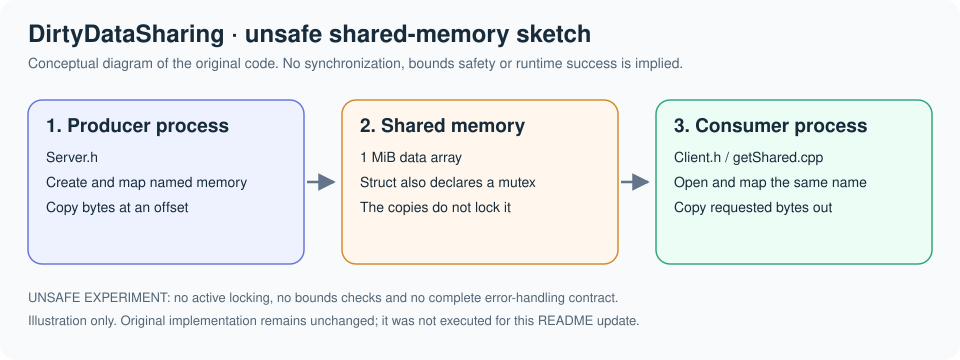

# DirtyDataSharing

[](Server.h)
[](Client.h)
[](#validation-and-limitations)

DirtyDataSharing copies byte ranges between processes through a named shared-memory object.
A C++ writer creates the object; a C++ reader or MATLAB MEX function opens it and copies bytes
into the caller's buffer. The byte-copy interface uses neither a file serialization step nor a socket protocol.



*Source-level schematic, not a runtime result. The structure contains a mutex, but the byte copies do not lock it.*

## Implementation

- [Server.h](Server.h): on its first call, `setupSharedMemory(name)` removes an existing object of
  that name, creates a new one and maps a structure containing a mutex and a 1 MiB byte array.
  A static guard skips this work on later calls, even for a different name. Shutdown does not
  reset the guard, so setup after shutdown does not recreate the named object. `setSharedData(data,
  offset, size)` copies bytes into that array, or fills the range with zeros if `data` is null.
  `shutdownSharedMemory(name)` removes the name.
- [Client.h](Client.h): `getSharedData(name, buffer, offset, size)` opens the object and copies
  the requested bytes into a buffer supplied by the caller.
- [getShared.cpp](getShared.cpp): MATLAB MEX reader with the same copy operation. It returns a
  `size`-by-1 `uint8` array.

The shared structure is a native C++ memory layout, not a portable interchange format. Both
processes must agree on that layout, the object name and the meaning of every byte range.

## Build and use

The C++ code requires a compiler and Boost.Interprocess headers. It is not a standalone program:
there is no supplied producer executable, build system or end-to-end example. Include the writer
and reader in separate programs and initialize the object before reading it.

For the MATLAB reader, configure a MEX-compatible C++ compiler and supply the Boost include path:

```matlab
mex getShared.cpp -I/path/to/boost
bytes = getShared('object_name', 0, 16);
```

The MEX source records a Windows build using Boost 1.48.0. The command above describes the
interface; it was not compiled or run for this documentation review.

## Validation and limitations

Review date: 2026-11-12.

This documentation revision inspected all three source files; it did not compile or run them.
There is no test suite or recorded successful execution in this repository.

Neither reader nor writer checks byte offsets or lengths. A range outside the 1 MiB array
accesses memory outside that array, with undefined behavior and possible memory corruption. The MEX entry point does not validate
its argument count or types. Concurrent reads and writes can observe partial updates, and reader
exceptions are printed rather than returned through a complete error contract. The writer also
removes an existing object during its first setup call. These behaviors need redesign before use
as a reliable interchange layer.

## Attribution and license

The original implementation is unchanged. The repository does not contain a software license;
these documentation changes do not assign one.
